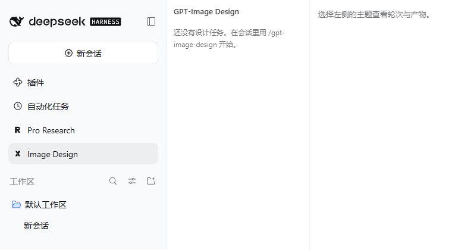

# GPT-Image Design

在 DeepSeek Harness（DSH）里，用真实的 ChatGPT 网页会话，或任意 OpenAI 兼容生图 API，出设计图与单文件 HTML demo。**web 通道可同时产出图片和 HTML demo；API 通道只产出图片，不产出 HTML。** 图片和代码保存到本地，侧边栏画廊预览，iframe 直接打开 demo。

[](https://dsh.pub/zh/plugins/gpt-image-design/)
[](https://www.npmjs.com/package/gpt-image-design)
[](LICENSE)


> English: Generate images and standalone HTML demos through ChatGPT on the web, or images through an OpenAI-compatible image API. Keep artifacts and versioned delivery notes locally in DSH.

> **风险提示**：`web` 通道是网页自动化，不是官方 API；页面改版、账号风控与 ToS 风险由使用者承担。`api` 通道按服务商条款计费，只产出图片，不产出 HTML demo。



*已完成设计主题：本版图片、本轮 demo，以及「取回 / 待人工确认」状态；取回数量不等于验收。*

## 两种通道

| 通道 | 适合 | 产出 |
|---|---|---|
| `web`（默认） | 使用 ChatGPT 网页账号，想顺带生成 HTML demo；能力与额度以该账号为准 | 图片 + 前端代码/HTML demo |
| `api` | 想用 `gpt-image-1` 等 API 的质量/尺寸/参考图控制 | 只有图片；HTML demo 由 agent 另行生成 |

## 它解决什么问题

- 一句话生成多个方向的设计图，并把每轮结果按主题和轮次落盘。
- 侧边栏「Image Design」提供画廊、demo iframe 预览和设计决策记录。
- 材料里的图片可以作为参考图（`api` 通道走 `/images/edits`），最多 4 张、每张 25MB。
- 适合落地页/海报/UI 方向探索；不适合需要像素级精确排版、或必须使用特定品牌规范自动校验的场景。


## 0.3.6：Pro 优先，免费账号自动回退

网页模型默认 `prefer-pro`：优先选中可用 Pro，没有可用 Pro 才沿用当前模型；禁用、锁定和升级入口不算可用 Pro。已有配置需改为 `prefer-pro` 后新建主题；旧主题保留原模型。显式 `auto` 保留当前选择，显式指定模型仍须核验；可用 Pro 选择失败时停止发送。图片、附件与额度以账号能力为准，API 生图设置不受影响。

## 0.3.5：API 安全与运行一致性

- 自检与生成共用 URL/协议/配置检查；除本机 loopback 外必须 HTTPS，所有 API/下载重定向明确拒绝，请配置最终直达 endpoint 或直链。
- 致命错误立即取消同轮其他并发请求，并等待清理；模型列表、生成 JSON、错误正文和图片下载均有流式字节上限，每方向只接收请求的 1 张图片。
- 按实际 key 脱敏错误；跨源 CDN 直链下载不带 API key。参考图、预览、下载、原生打开及 ZIP 校验真实路径，越界链接和缺失材料不会继续外发。
- 修复授权轮次重试预算、两轮间恢复、裁决取消及新版接受时误用旧摘要。完整审查与验证边界见 [0.3.5 记录](https://github.com/Octo-o-o-o/dsh-pro/blob/main/docs/validation/release-0.3.5-2026-10-29.md)。
- 0.3.5 阶段只发布 Git，npm 当时为 0.3.4；社区市场版本独立。视觉与交互质量仍需实际验收。

## 0.3.4：可靠裁决与 local 交付（已保留）

- 裁决为推理与 JSON 预留共同的输出预算；只有正常完成且判据满足才接受。
- `read_round` 读取真实答复/裁决；`read_report` 返回旧稿及 revision；`write_report` 写入已授权主题的固定交付文件。
- 支持 `project` / `local`，不要求放宽宿主文件权限；写稿经过 DSH 工具权限检查，带版本与轮次覆盖校验及并发覆盖保护。
- 原答复、运行汇总与宿主整理的交付稿分别保留。设计图片与 HTML 必须另做视觉、交互验收。

## 前置条件

- DSH `>= 0.2.1-rc.3 < 0.3.0`（本版本实测 `0.2.1-rc.3`）。
- Node.js 22+（DSH 自带 runtime 也可以）。
- `web` 通道：本机 Google Chrome + 可登录 ChatGPT 网页的账号；首次登录必须有人工操作。
- `api` 通道：一个 OpenAI 兼容的生图服务、base URL、key 和模型名。
- `web` 通道固定单账号、单会话，与研究插件共用同一个 Chrome profile。

## 安装

### 从 Git commit（当前推荐）

```bash
dsh plugin --profile <profile> add github:Octo-o-o-o/gpt-image-design#<40-char-commit>
```

`<40-char-commit>` 用 `v0.3.6` tag 对应完整 SHA；`<profile>` 换成你的 profile（例如 `desktop`、`web`）。本版 `0.3.6` 包含 Pro 优先与免费回退；请核对 Release 已发布再安装。本版也包含 0.3.5 的共享状态机和 API 加固。

### 从 dsh.pub（收录后推荐）

```bash
npx dshpub add Octo-o-o-o/gpt-image-design
```

dsh.pub 会把仓库固定到一个公开 commit 再安装。市场收录与 Git/npm 发版独立，安装前请核对市场显示的版本与 commit。

### 从 npm

```bash
dsh plugin --profile <profile> add gpt-image-design@0.3.6
```

安装时固定版本 `@0.3.6`，便于复现；`desktop` 与 `web` profile 均受支持。

### 启用

安装后重启 DSH，打开 **设置 → 插件**，确认 **GPT-Image Design** 已启用；工具列表会出现 `gpt_image_design`，侧边栏会出现 **Image Design** 面板。

## 首次登录（web 通道）

```text
gpt_image_design(action="login")
```

插件会打开一个独立的 Chrome 窗口。登录 ChatGPT 后关闭窗口即可；登录态保存在 `~/.dsh/pro-research/browser`，与研究插件共用，只需登录一次。

`api` 通道不需要登录；配好 key 后用 `probe` 自检。

## 快速开始

### web 通道：第一次先跑一张图 + 一个 demo

不需要准备材料，单轮单方向：

```text
gpt_image_design(
  action="start",
  confirmed=true,
  title="第一次试跑",
  question="生成一个深色落地页首屏，并给一个可打开的单文件 HTML demo",
  brief="深色科技风，中文大标题，右侧产品界面，单文件 HTML",
  criteria=["至少 1 张完整首屏图", "一个可打开的 HTML demo"],
  rounds=1,
  designs=1
)
```

确认链路后，再按方向数/轮次扩展：

```text
gpt_image_design(
  action="start",
  confirmed=true,
  title="落地页首屏",
  question="生成 3 个方向的首屏设计图和 1 个 HTML demo",
  brief="深色科技风，中文大标题，右侧产品界面，单文件 HTML",
  criteria=["至少 1 张完整首屏图", "一个可打开的 HTML demo"],
  rounds=2,
  designs=3
)
```

产物写入 `<主题>/artifacts/round-NN/`：

```text
<project>/docs/design/<slug>/
├── topic.json
├── artifacts/round-01/
│   ├── image-01.png
│   ├── image-02.png
│   └── code-01.html
└── ...
```

- `image-*.png`：ChatGPT 生成的图片。
- `code-*.html`：前端代码块；单文件 HTML 可在面板 iframe 预览。

### API 通道

在 **设置 → 插件 → GPT-Image Design** 里把 `channel` 改成 `api`，并填写：

| 设置 | 默认 | 说明 |
|---|---|---|
| `channel` | `web` | `web` 或 `api`。 |
| `imageBaseUrl` | `https://api.openai.com/v1` | 含版本前缀的 API 根地址。 |
| `imageApiKey` | 空 | key；留空则读环境变量 `GPT_IMAGE_API_KEY`。 |
| `imageModel` | `gpt-image-1` | 模型名，例如 `gpt-image-1`、`dall-e-3` 或服务商模型名。 |
| `imageSize` | `auto` | `auto` 或 `1024x1024` / `1536x1024` / `1024x1536` 等。 |
| `imageQuality` | `auto` | `auto` / `low` / `medium` / `high`（服务商支持时生效）。 |
| `imageFormat` | `png` | `png` / `jpeg` / `webp`。 |
| `imageAuth` | `bearer` | `bearer`（`Authorization: Bearer`）或 `api-key`（Azure 风格）。 |
| `imageEdit` | `auto` | 材料里的图片是否作为参考图发给 `/images/edits`：`auto` / `off`。 |
| `imageTimeoutSeconds` | `300` | 单张图片的生成/下载超时（秒，10–3600）。 |

自检：

```text
gpt_image_design(action="probe")
```

返回 `channel: "api"`、`probe.ok`、模型列表或 `probe.reason`。`ok=false` 时先看 reason（key、base URL、模型名）。

改完设置或环境变量后要重载插件（重启 DSH）才生效；进行中的主题不受影响。

如果设置页没有渲染这些项，可以直接写进 profile 的 `cordis.patch.yml`（`~/.dsh/profiles/<profile>/cordis.patch.yml`）：

```yaml
- id: gpt-image-design
  name: gpt-image-design
  config:
    channel: api
    imageBaseUrl: https://api.openai.com/v1
    imageApiKey: <your-key>        # 或用环境变量 GPT_IMAGE_API_KEY
    imageModel: gpt-image-1
    imageSize: 1536x1024
```

### API 通道发起

```text
gpt_image_design(
  action="start",
  confirmed=true,
  title="深色首屏",
  question="出三个方向的首屏",
  brief="深色科技风，中文大标题，右侧产品界面",
  criteria=["三张图方向可区分", "标题中文可读"],
  designs=3
)
```

每个方向调用一次生图接口（`designs=3` 就是 3 次请求），图片保存到 `artifacts/round-NN/image-01.png` 等。

### 接口约定

- `POST {imageBaseUrl}/images/generations`，JSON：`{model, prompt, n:1, size?, quality?, output_format?}`；
- 材料里有图片（`.png/.jpg/.jpeg/.webp`，最多 4 张、每张 25MB）且 `imageEdit=auto` 时改走 `POST {imageBaseUrl}/images/edits`（multipart，`image[]`）；
- 响应支持 `data[].b64_json`、`data[].url`；`url` 会下载后落盘，鉴权头只发给 `imageBaseUrl` 同源地址；
- 服务商必须兼容 OpenAI images 的参数名；用 `image_size`、`batch_size` 等自定义参数的服务商暂不支持。

### 成本与轮次

- 每轮 = `designs` 次生图请求，按 API 计费；没有配置自动裁决（`judgeProvider` + `judgeModel`）时，API 通道默认只跑 1 轮，避免重复计费。显式传 `rounds` 可覆盖。
- 自动裁决在 API 通道只看得到提示词与结果清单，看不到图片本身；更可靠的是人工复核，或不配裁决、跑 1 轮后用 `continue` 显式加轮。
- 部分方向失败不会丢掉已成功的图；失败原因写进该轮答复和面板记录。
- DSH 重启后，进行中的 API 请求会丢失，这一轮不会自动重发；已生成的图片仍在 `artifacts/` 里。

## 设置（通用）

以下设置两个通道都有：

| 设置 | 默认 | 说明 |
|---|---|---|
| `rounds` | `3` | 每个主题默认轮次上限（1–10）。 |
| `designs` | `3` | 每轮生成的方向/图片数（1–6）。 |
| `model` | `prefer-pro` | `web` 通道优先使用可用 Pro，没有才沿用当前模型；`auto` 保留当前选择，指定其他模型须可用。 |
| `store` | `project` | 记录位置：`project`（仓库 `docs/design`）或 `local`（DSH 本机）。 |
| `autoStart` | `false` | 设计卡是否跳过点击直接开跑。 |
| `autoReview` | `true` | capped 后唤醒原会话检查产物。 |
| `notify` | `stall-only` | `stall-only` 只在卡住时提醒，`all` 完成也提醒。 |
| `stallMinutes` | `45` | 无进展判定分钟数。 |
| `maxRoundMinutes` | `90` | 单轮墙钟上限（分钟）。 |
| `maxFiles` | `12` | 单轮附件数量上限。 |
| `maxTotalMB` | `24` | 单轮附件总大小（MB）。 |
| `rawAnswers` | `local` | 原始答复保存位置：`local` 或 `repo`。 |
| `rawAnswersDir` | 空 | `local` 模式的原文目录。 |
| `headless` | `false` | 无头模式仅建议用于自检。 |
| `judgeProvider` | 空 | 自动裁决的 LLM provider；填 `off` 关闭。 |
| `judgeModel` | 空 | 自动裁决的 model。 |

## 产物与记录

- `store=project`：`<项目>/docs/design/`（设计插件使用 `docs/design`）。
- `store=local`：`~/.dsh/gpt-image-design/projects/<project>-<hash>/<slug>/`。
- 原始答复默认只在 `~/.dsh/gpt-image-design/raw/<topic-id>/`；`rawAnswers=repo` 才复制进项目。
- API 通道的答复是提示词与结果清单（纯文本），不是模型自然语言回复。
- 登录态：`~/.dsh/pro-research/browser`（与研究插件共用，敏感，不要提交）。

## 验证清单

1. 工具列表出现 `gpt_image_design`，侧边栏出现 **Image Design** 面板。
2. `action="probe"` 返回当前通道和状态；`web` 通道显示登录态，`api` 通道显示模型/接口检查结果。
3. 跑一个 1 轮小主题，确认 `artifacts/round-01/` 下有图片；`web` 通道还应出现 `code-*.html`。
4. 面板里能打开画廊，点击 demo 能在 iframe 里预览；概览显示「取回 X/Y 张、HTML 是否取回、视觉待人工确认」。
5. 刷新侧边栏，确认主题、轮次、产物路径都在。

## 安全与隐私

- **会出网**：`web` 通道把问题、brief、判据和材料发送到 `chatgpt.com`；`api` 通道发送到你配置的 `imageBaseUrl`。
- **本地保存**：登录态在 `~/.dsh/pro-research/browser`（与研究插件共用）；图片/代码在项目 `docs/design` 或 `~/.dsh/gpt-image-design`；原始答复在 `~/.dsh/gpt-image-design/raw`。
- **key 处理**：key 只来自插件设置或 `GPT_IMAGE_API_KEY`；不会写进 `topic.json`、回执、日志或错误信息（错误体做了脱敏）。
- **权限边界**：插件以 DSH 进程权限运行，可以读写上述目录、启动本机 Chrome、请求你配置的生图服务；不会把 key 发给 `imageBaseUrl` 之外的地址，也不会把参考图发给其他服务商。
- **文件管理器**：插件先把路径限制在 topic 目录内，再把路径作为参数数组交给 `explorer.exe` / `open` / `xdg-open`；不经过 shell，也不把路径拼进命令行。
- **清理**：面板「更多 → 删除主题」或 `action=delete`（终态主题、需 `confirmed=true`）会删除主题目录、原始答复与面板记录；卸载时见下文。不要把 key、登录态或 `~/.dsh` 提交到仓库。

## 已知限制

- `web` 通道受页面改版、Cloudflare、账号风控、额度限制影响；失败时保留已完成轮次，不假装成功。
- `web` 通道只支持单账号、单会话；不支持多账号并行。
- `api` 通道只支持 OpenAI images 参数名；自定义参数服务商暂不支持。
- 自动裁决在 API 通道看不到图片本身，不等同于视觉评审；重要结果请人工看画廊。面板只显示「取回 X/Y 张、HTML 是否取回、视觉待人工确认」，取回数量不等于验收通过。
- 单轮图片数、附件大小、超时受 `designs` / `maxFiles` / `maxTotalMB` / `imageTimeoutSeconds` 限制。
- 页面上的模型/功能以 ChatGPT 网页实际提供为准。

## 故障排查

| 现象 | 先检查 |
|---|---|
| `web` 登录窗口没出现 | 是否有残留的插件 Chrome 窗口占用 profile；关掉后重试 `login`。 |
| 登录后仍显示未登录 | `probe` 看状态；确认 `~/.dsh/pro-research/browser` 可写；必要时重新 `login`。 |
| `api` 返回 401 | key、`imageAuth`（`bearer` / `api-key`）、base URL 是否匹配服务商。 |
| `api` 返回 404 | `imageBaseUrl` 是否包含版本前缀，模型名是否存在。 |
| 只有部分方向成功 | 这是允许的；看该轮答复里的失败原因，已成功的图不会丢。 |
| demo 在 iframe 里打不开 | 确认 `code-*.html` 是单文件 HTML；外链资源可能被 iframe 限制。 |
| 参考图没发出去 | 检查材料格式（png/jpg/jpeg/webp）、数量（最多 4 张）、大小（每张 25MB）和 `imageEdit`。 |
| 改设置不生效 | 需要重启 DSH 重载插件；进行中的主题不受影响。 |

## 本地验证记录

2026-10-23，DSH `0.2.1-rc.2`，空 `web` profile，从公开 commit `e29502c` 安装：

- `--dump-config` 显示 `# == gpt-image-design` 组合包层；
- `GET /gpt-image-design/topics` 返回 `200 {"topics":[]}`；
- 侧边栏 **Image Design** 入口和空面板正常加载。

> 这是安装/加载验证，不等于真实网页登录或真实生图 API 的验收；`web` 通道需要你自己的 ChatGPT 账号，`api` 通道需要自己的服务商 key。

## 0.3.4 验证边界

本版将裁决输出预算提高到 8,192 token，避免推理耗尽预算后截断 JSON；异常仍保留原答复与结束原因，不会误判成功。新增固定主题范围的交付工具，支持宿主在“工作区内修改”模式下整理 local 交付稿。首次人工登录、付费生图 API、macOS/Linux 真实端到端仍需各环境独立验收。

2026-10-29 在 Windows、DSH `0.2.1-rc.3` 完成真实网页验收：第 1 轮取回 1254×1254 PNG，第 2 轮补齐单文件 HTML；裁决使用保存答案恢复并正常返回 `partial`，把视觉和交互留给实际检查。图片已目视核对，HTML 在 DSH 预览中实测 Start→Done；local `design.md` 通过插件写入并回读。详情见 [0.3.4 验证记录](https://github.com/Octo-o-o-o/dsh-pro/blob/main/docs/validation/release-0.3.4-2026-10-29.md)。

宿主用 `read_round` 核对实际证据，`read_report` 取旧稿与 revision，再调用 `write_report` 写入固定的 `design.md`；面板显示为“宿主交付稿”，兼容旧 `report.md`。插件自动记录覆盖范围并拒绝过时轮次、跨项目、目录链接或旧 revision；视觉与交互仍需实际验收。

## 兼容性

| 项 | 值 |
|---|---|
| DSH | `0.2.1-rc.3` 实测；`engines.dsh` 为 `>=0.2.1-rc.3 <0.3.0` |
| Node.js | 22+ |
| 浏览器 | `web` 通道需要本机 Google Chrome（稳定版） |
| API | 任意兼容 OpenAI images 参数名的服务 |
| 平台 | Windows 已验证；macOS/Linux 使用对应的 Chrome 启动路径，未在仓库内声明实测 |
| 插件版本 | `0.3.6`（渠道回执见 Release 与源码验证记录） |

## 禁用与卸载

**临时禁用**：**设置 → 插件** 关闭 **GPT-Image Design**；或从 profile 的 `dsh.profile.bundles` 移除 `gpt-image-design`，重启 DSH。

**卸载**：

```bash
dsh plugin --profile <profile> remove gpt-image-design
```

然后按需删除：

- `~/.dsh/gpt-image-design/`（原始答复、registry、sessions 与 `store=local` 的记录）
- `~/.dsh/pro-research/browser/`（如果你也不再使用研究插件；两个插件共用登录态）
- 项目里的 `docs/design/`（只删你确认不要的主题）

## 开发

源码和开发说明在 monorepo：[Octo-o-o-o/dsh-pro](https://github.com/Octo-o-o-o/dsh-pro/tree/main/packages/design)。

```bash
npm install
npm test
npm run typecheck
npm run build
node scripts/smoke-bundle.mjs
```

本仓库是发布仓库：`lib/` 是构建产物，请不要直接改 `lib/`；改源码请到 monorepo 的 `packages/design`。

## License

MIT。
